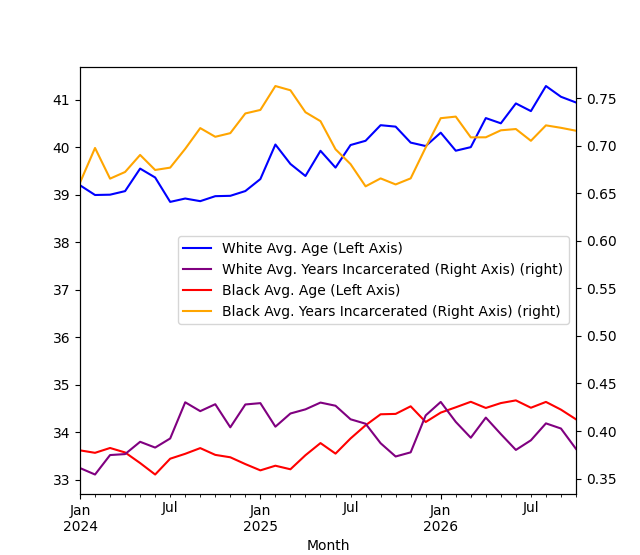

# WPRDC ACJ Daily Census Excersize

## Excercise goal: 
Build a small, reproducible pipeline that ingests data from the WPRDC CKAN API, producing a clean analytical table that shares something useful about the data. Completed script and markdown document should be available in a public GitHub or GitLab repository.

## Requirements

* [X] Ingest the data programmatically (CKAN API or resource URL). No manual downloads.
* [X] Land raw data unchanged, then transform into a cleaned/modeled layer. Use any local stack you like (Python, SQL, DuckDB, SQLite, Postgres via Docker, dbt, etc). No cloud accounts required.
* [X] Make it re-runnable. Running it twice must not duplicate or corrupt data. Explain how you’d handle the dataset being updated.
* [X] Add data quality checks that would actually fail on bad data. Include at least one check you wrote because of something you found in this dataset.
* [X] Produce one output table that could be used to answer a question you chose (state the question).
* [X] Write a README.md covering decision you made in the process: the three most important design decisions and the alternatives you rejected, what surprised you in the data, what you’d do differently at 100x scale or with daily refreshes, and what you didn’t do and why.
* [X] AI disclosure: AI tools are allowed. Tell us which you used and for what purpose. We will ask you to walk through your code live should you progress to an interview round.

## Data Sets
- [ ] Allegheny County Property Sale Transactions
- [ ] Allegheny County Weights and Measures Inspections 
- [ ] Allegheny County Air Quality
- [X] Allegheny County Jail Census

### Research question:
_Does the length of a prisoner's stay at the jail influence the average age of the jail population? And does this influence impact different racial groups, specfically when comparing white and black prisoner populations?_

## Project Design

Attempted to use the ckan python library/wrapper suggested by the WPRDC, but the package had download conflicts due to a defunct dependency. Opted to use python requests library to interact with the REST API. 

To ensure regular, programmatic access to the resource, I opted to employ SQL payloads and interact with the datastore_search_sql endpoint on the API. This provides the easiest method for controlling the return from this dataset using simple SQL filters and select statements. Otherwise, API calls will pull the entirety of the dataset and its 8 million rows. 

Data engineering best practices encourage pipelines with idempotent operations. Idempotency should be able to run multiple times without changing the result beyond the initial load. With this census dataset, we have a a unique record ID as well as the census date. For the purpose of this excersize, I've opted to use only the census date to control my sql query and ensure reliable and repeatable datafeeds. If I were to transform this script into a pipeline feeding a multi-million row database table, I use the unique record id in conjuction with this census date to bring in and replace records when they are brought in by the pull script. 

 To cope with the 32000 row limit for api calls, I had to develop a pagination method. So in a python function called fetch_ckan_data_page, I use the SQL limit clause to control the rows returned, then used the OFFSET clause (applicable to postgresql) to gather the next rows avaialble within the dataset. Even though this pagination would allow me to query records throughout my desired date range (two years previous), I wanted to build monthly intervals to form the basis of my query date ranges so as to not potentially overwhelm the API endpoint. My testing suggested that a monthly data pull with a 20000 row limit achieved a reliable and stable method to gather the data.

For data validation, while I rely on traditional pandas filters to ensure data values would be valid for analysis, I also employed a pydantic data model. This ensures that my API call returned the full list of expected columns as well as the formats necessary to achieve my analysis. In particular, I needed to ensure numeric values for the age fields and a date column within census_date. I also added date validation to the API call to ensure date range values added at the head of the script were valid. I produced an error inadvertantly when I ended a search range on February 30th, an invalid date. This is a valuable control to have in place when transforming this pull script into a durable and extensible pipeline. 

I produced a data model by pivoting across race and month with mean census age and mean years incarcerated (a calculated field based on census_age and entry date) as my value fields. I thought average incarceration length and average age would be positively correlated and that race would also produce distinct effects on either measuure. While not statistically significant, not only did this relationship not prove positive, it actually produced a negative association depending on race. For white prisoners, average age increased steadily even as marked decreases were observed in average years incarcerated, especially during 2026. For black prisoners, at around the second half of 2025, large decreases in average age actually coincided with an increase in the average years incarcerated. I don't believe the association suggests causality in anyway, but it does suggest other factors influencing this metrics such as the charge type or previous criminal records.   

## AI Disclosure
The only AI assitance utilized within this project involved returns from Google's Gemini AI when searching for relevant functions and libraries within google. The pydantic/pandantic data modeling was primarily derived from examples offered by Gemini, which heavily sourced from a [Medium article](https://wesselhuising.medium.com/validate-pandas-dataframes-using-pydantic-pandantic-4ec89709d5d). I also used Gemini to assist in developing the helper functions for the month ranges, though I have applied similar helpers in my own code previously. I also relied upon Gemini heavily for the plotting within matplotlib seeing as my recent experience with python has focused on data engineering tools as opposed to data visualization. 
